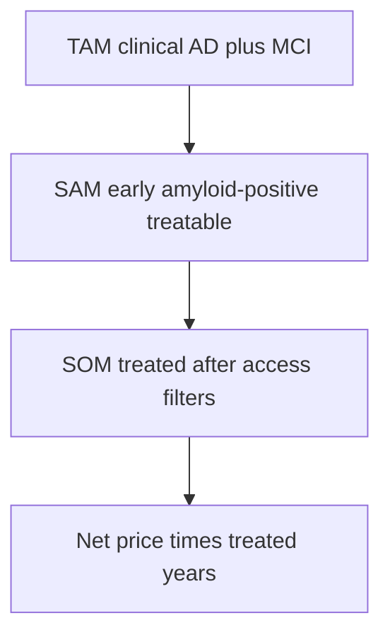

# US market, payers, and pricing — NVL-101

Living sketch. Not a forecast. Not investment advice. Sources at the foot of this file.

## 1. Demand (how many people)

Alzheimer’s Association *2025 Facts and Figures*: **7.2 million** Americans age 65+ live with clinical Alzheimer’s dementia. About three-quarters are 75+. The same report estimates **5–7 million** additional older adults may have MCI *due to* Alzheimer’s when biomarker studies (roughly half of all-cause MCI is amyloid-positive) are applied. Combining biomarker-adjusted dementia plus MCI due to AD yields on the order of **10–12 million** older Americans with Alzheimer pathology *and* some cognitive impairment.

NVL-101’s TPP is **early / prodromal, amyloid-positive** — not moderate–severe dementia. The practical funnel is therefore MCI due to AD plus mild dementia, not the 7.2 million headline.

| Layer | Order of magnitude (US, mid-2020s) | Filter |
|---|---|---|
| 65+ population | ~60 million | Census |
| Clinical AD dementia | 7.2 million | Alz Assoc 2025 |
| MCI due to AD (biomarker-informed) | 5–7 million | Alz Assoc 2025 synthesis |
| Early-stage and amyloid-confirmed (PET/CSF/blood) | low millions | diagnosis + test access |
| Fit for a specialist DMT (infusion capacity, MRI, APOE, comorbidities) | hundreds of thousands | today’s anti-amyloid bottleneck |
| Actually treated with Leqembi/Kisunla | tens of thousands, growing | CED, capacity, ARIA |

Do not pitch TAM as 7 million treated patients. The commercial analog class has already shown that **access friction**, not prevalence, sets volume.

## 2. Who pays

Almost all eligible patients are **Medicare age**. Commercial plans matter for early-onset and dual-eligible wraparound. Medicaid matters as the 20% coinsurance payer for duals.

### Medicare (primary)

CMS covers FDA-approved anti-amyloid monoclonal antibodies for **MCI due to AD or mild AD dementia with confirmed amyloid** under **NCD 200.3**, **Coverage with Evidence Development**. The clinician must enroll the patient in the CMS-facilitated registry (or another CMS-approved study). Drug is **Part B** (buy-and-bill) when given IV in office or hospital outpatient. HCPCS examples: J0174 (Leqembi, 1 mg), J0175 (Kisunla, 2 mg).

Beneficiary cost on original Medicare: Part B deductible (about **$283 in 2026** on some published schedules; confirm annually) then **20% coinsurance** with **no Part B OOP cap**. Medigap or dual Medicaid usually eats that 20%. Medicare Advantage follows the NCD but can add prior auth and site-of-care rules.

Amyloid PET: CMS expanded coverage to **one scan per lifetime** for qualifying use (October 2023 policy direction). MRI surveillance for ARIA is Part B imaging, not free.

If NVL-101 is IV (or IT in a facility), expect the **same Part B + CED-like evidence demand** that CMS already uses for a first-in-class AD biologic. A subcutaneous future product could land in **Part D**, where the IRA redesign caps beneficiary prescription OOP (published **$2,100 in 2026** for Part D). That is a different patient-affordability story than Part B 20%.

### Commercial and Medicaid

National plans (Aetna CPB example for Kisunla) require amyloid confirmation, specialist prescriber, no combination with another anti-amyloid, and precertification. They often shadow the FDA label and the CMS stage gate even when they are not bound by NCD 200.3. Dual-eligible patients: Medicare pays the drug; Medicaid often pays the coinsurance — a real volume channel.

## 3. Price anchors already in the market

| Product | List / WAC band (published) | Benefit |
|---|---|---|
| Leqembi IV | ~$26,500–$28,300/year (weight-based; Eisai list math ~$28,270 for 165 lb) | Part B |
| Kisunla IV | ~$32,000/year list; stop when amyloid clears | Part B |
| Leqembi IQLIK SC | $385 per 360 mg autoinjector; initiation with two 250 mg devices is a higher year-1 bill | Likely Part D once coverage is written |

Ancillary spend (PET, serial MRI, infusion chair, APOE) is thousands more per year and is what UCLA-type budget papers add when they talk about **$2–5 billion** incremental Medicare spend if uptake scales.

**ICER / payer posture:** anti-amyloid antibodies were judged to have modest clinical benefit at launch prices. CMS did not refuse coverage; it attached CED. That is the template NVL-101 should assume: **coverage with homework**, not a blank check and not a hard no.

## 4. Pricing strategy for NVL-101

Do not price like a one-time gene therapy. Do not price like donepezil. Price like a **chronic-or-intermittent specialty DMT** that must sit next to $26–32k antibodies.

**Rule:** net price is earned by human PD (CSF sTREM2 / imaging) plus a safety story that is not worse than ARIA. Until then, the number is a planning band only.

| Principle | Implication |
|---|---|
| Reference analog | Leqembi / Kisunla list, not Spinraza / Zolgensma |
| Benefit design | Prefer Part B IV if we need buy-and-bill and registry familiarity; Part D only if a future SC exists |
| Combination | If used *on top of* an anti-amyloid, payers will demand a lower net or a tight biomarker stop rule |
| Duration | Intermittent 4–12 week dosing can support a higher *per-dose* price than q2week Leqembi if annual net stays in-band |
| CED risk | Budget a registry and outcomes contract; do not assume unrestricted Part B on day one |
| Medicaid / 340B | Hospital outpatient 340B will compress net; model 20–40% gross-to-net in the pessimistic case |

## 5. Cases (planning, not a model)

Assumptions that are explicit so they can be killed:

- Eligible pool after amyloid test + early stage + fit for a parenteral DMT: **400,000** (pessimistic treated-capacity view of the early-AD specialist channel) vs **1,200,000** (optimistic if blood tests and SC/IV capacity open the funnel).
- Peak share of that pool on NVL-101 in a world where antibodies already exist.
- Duration on drug: 2 years pessimistic / 4 years optimistic.
- Gross-to-net: 40% off pessimistic / 25% off optimistic.

### Pessimistic

- Indication stuck behind a CMS-style CED registry; IV only; ARIA-adjacent MRI burden even if mechanism differs.
- List **$18,000/year**. Net ~$11,000.
- Peak treated US patients: **8,000** (2% of a tight 400k channel).
- Peak US net sales: ~**$90 million**.
- Why this happens: no incremental benefit vs agonism; CSF-only route; infection or complement tax; 340B + Medicaid best-price drag.

### Base

- List **$28,000/year** (Leqembi neighborhood). Net ~$20,000.
- Peak treated: **25,000**.
- Peak US net sales: ~**$500 million**.
- Why: myeloid PD in humans, add-on or alternative in antibody-intolerant / TREM2-variant patients, Part B pathway that CMS already understands.

### Optimistic

- List **$42,000/year** justified as combination or as a less frequent IV with clean CSF PD. Net ~$32,000.
- Peak treated: **80,000** (blood-test diagnosis + easier administration).
- Peak US net sales: ~**$2.5 billion**.
- Why: copy-number story wins in R47H / TREM2-low biology, IV works, CED sunsets, used with or after anti-amyloid.

These are **peak-year illustrations**, not NPVs. COGS must stay in the low thousands per year of therapy or the pessimistic case is a nonprofit.

## 6. What to tell a payer medical director

1. Same patient CMS already covers for Leqembi/Kisunla (early, amyloid+).
2. Different cell and different lever (receptor mass, not plaque mAb).
3. We will fund the evidence CMS will demand (registry-grade PD and safety).
4. We will not ask for Zolgensma economics.
5. Stop rules and combination policy will be written before launch, not after a denial letter.

## Sources

- Alzheimer’s Association. *2025 Alzheimer’s Disease Facts and Figures.* 7.2 million US adults 65+ with Alzheimer’s dementia; MCI-due-to-AD synthesis ~5–7 million.
- CMS. *NCD 200.3* Monoclonal Antibodies Directed Against Amyloid for the Treatment of Alzheimer’s Disease. CED registry required.
- Medicare.gov. Monoclonal antibodies for treating early Alzheimer’s disease (Part B; Leqembi, Kisunla named).
- First Coast Service Options / Medicare contractors. Kisunla billing under NCD 200.3; HCPCS J0175; ICD-10 G30.x or G31.84 plus Z00.6 for registry.
- Eisai Leqembi patient-support list prices (as of July 2026): IV ~$28,270/year at 165 lb; IQLIK $385 per 360 mg injector.
- Manufacturer and secondary reports: Kisunla ~$32,000/year list.
- UCLA Health / published Medicare-spend estimates: lecanemab plus ancillaries could add $2–5 billion per year at scale.
- Inflation Reduction Act Part D redesign: $2,100 beneficiary cap cited for 2026 covered Part D drugs (SC products only if placed on Part D).
- Aetna CPB 1066 (Kisunla commercial medical policy): amyloid confirmation, specialist, no dual anti-amyloid.
