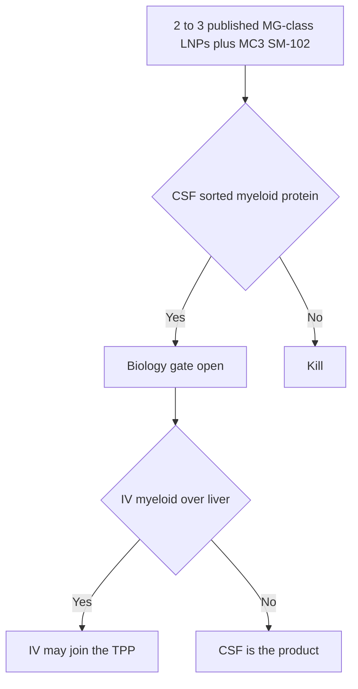

# Delivery

Numbered notes point to [references.md](references.md). Operating plan: [09-solutions-1-3.md](09-solutions-1-3.md).

## Two problems

1. **Access** — particle must reach brain interstitial space (cross BBB or bypass it).
2. **Tropism** — once there, it must transfect *microglia*, not merely neurons and astrocytes.

An IVIS glow of the skull after IV luciferase is not a pass. TREM2 or reporter **protein** in FACS-sorted parenchymal myeloid cells is a pass.

CSF is the **PD-enabling** route. IV is a parallel commercial option. IV failure does not kill the biology.

## Routes

| Route | Role |
|---|---|
| CSF (intracisternal mouse; lumbar IT as human analog) | First exposure assay. Highest published prior for microglia transfection. |
| Intravenous | Run in parallel. Wins only if myeloid/liver ratio is acceptable. |
| Intranasal / FUS | Out of scope. |

## LNP set (seed)

Do not raffle 40 novel ionizable lipids.

- **Controls:** DLin-MC3-DMA and SM-102.[[10]](references.md)[[9]](references.md)
- **Test:** reproduce or in-license 2–3 published microglia-competent compositions (MG-LNP class; EV-mimetic helper-lipid hits with Ai9/Cre microglia data). One extra charge/SORT variant only if already on the bench.
- PEG-lipid: 0.5–2.5 mol%; prefer shedding C14 unless tropism forbids it.[[13]](references.md)

**Hold constant:** 60–100 nm, PDI ≤ 0.2, encapsulation ≥ 80%, empty fraction reported.

**Ligands:** none in v1. No CD11b, no HSC antibodies.

## Cargos for the screen

- Delivery RNA: Cre (Ai9) or mouse Trem2 — species-matched reagents.
- Product RNA: human WT TREM2 isoform 1, same particle family after the Cre/mouse pass.

Include one plaque-bearing 5xFAD / APP cohort in the *delivery* screen, not only in efficacy.[[11]](references.md)

## Biodistribution interpretation

| Observation | Meaning |
|---|---|
| Liver >> brain, no myeloid signal | Standard LNP. Fail IV. Keep CSF if that arm hits.[[10]](references.md) |
| Brain luciferase high, microglia negative | Wrong cell. Fail. |
| Endothelium / choroid / meninges only | Barrier hit. Fail. |
| Sorted parenchymal myeloid protein, cytokines tolerable | Pass. |

## Safety labs tied to delivery

Every in-vivo cohort: ALT/AST, cytokines, body weight. Repeat-dose: anti-PEG, complement, bone/liver/spleen histology. Full list: [10-safety.md](10-safety.md). Subtract empty LNP.[[8]](references.md)
