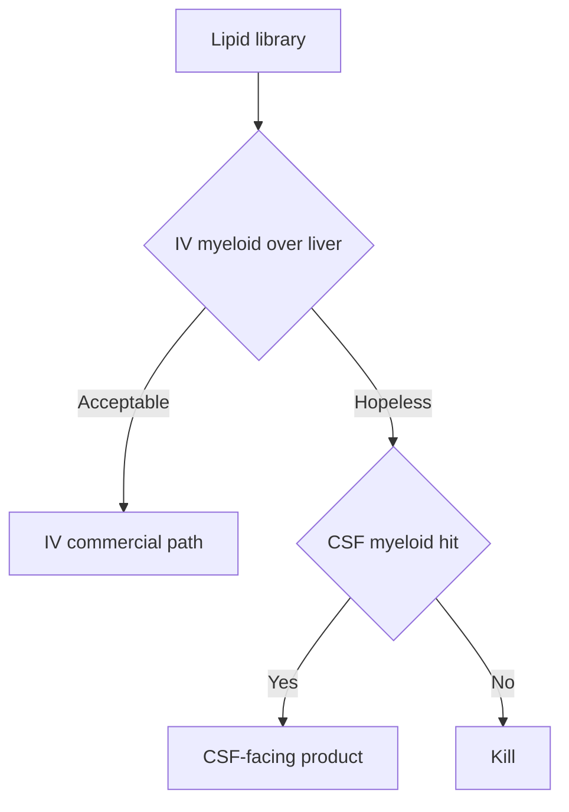

# Delivery

Numbered notes point to [references.md](references.md).

## Two problems

1. **Access** — particle must reach brain interstitial space (cross BBB or bypass it).
2. **Tropism** — once there, it must transfect *microglia*, not merely neurons and astrocytes.

An IVIS glow of the skull after IV luciferase is not a pass. Sorted myeloid cells with reporter or TREM2 protein is a pass.

## Routes

| Route | Role in the program |
|---|---|
| Intravenous | Intended commercial path. Must win or be explicitly deferred. |
| CSF (intracisternal / ICV / lumbar analog) | Scientific control and highest-probability myeloid hit. |
| Intranasal | Backup only if IV and CSF both fail practicality. |
| FUS + IV | Out of scope for seed. |

Decision rule: if IV myeloid/liver exposure is hopeless after the lipid library, **do not** add four antibodies. Switch the label-facing route to CSF or stop.

## LNP composition screen (seed)

**Controls:** DLin-MC3-DMA and SM-102 four-component LNPs. MC3 is the clinical ionizable lipid in patisiran (Onpattro).[[10]](references.md) Vaccine-style LNPs are the other baseline.[[9]](references.md)

**Test set (20–40 total):**

- Ionizable lipids with published CNS bias (5-HT3-motif, acetylcholine-mimetic, LRP1/BBB-module lipids in the MK16 / OS4T family — synthesize or license).
- Helper lipid and cholesterol ratios (±10 mol%).
- PEG-lipid mol% 0.5–2.5% and two PEG-lipid chain lengths.
- One SORT-style fifth lipid / charge variant if a partner lipid is available.

**Particle specs to hold constant while lipids vary:**

- Diameter 60–100 nm (intensity-weighted)
- PDI ≤ 0.2
- Encapsulation ≥ 80%
- Residual ethanol and empty-particle fraction reported

## Ligands

v1 is **ligand-free** or single small-molecule motif built into the lipid.

Optional v1.1, only if composition is close: mannose or anti-CD11b at one density. Do not start with CD34/CD90/c-Kit.

## Biodistribution interpretation

| Observation | Meaning |
|---|---|
| Liver >> brain, no myeloid signal | Standard LNP. Fail IV.[[10]](references.md) |
| Brain luciferase high, microglia negative | Neuron/astrocyte particle. Fail for TREM2. |
| Endothelium / choroid positive only | Barrier hit, not parenchyma. Fail. |
| Sorted microglia positive, liver acceptable | Pass. Measure TREM2 protein next. |

## Safety labs tied to delivery

Every in-vivo dose cohort: ALT/AST, plasma cytokines, body weight, histopathology on top compositions. Innate activation from the LNP can look like microglial activation.[[8]](references.md) Subtract empty LNP.
