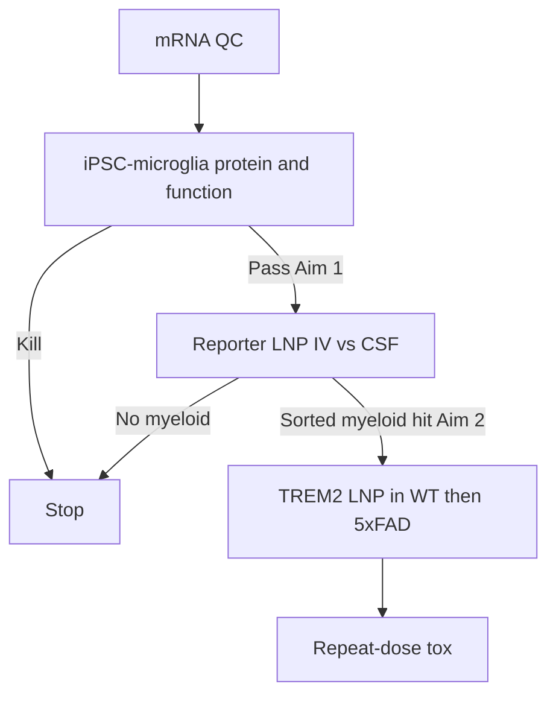

# Assays and decision numbers

## Cascade

Do not skip to Morris water maze.

## In vitro panel

| Assay | Platform | Pass (working) |
|---|---|---|
| mRNA integrity | Capillary electrophoresis | Single major peak, % intact ≥ 80 |
| TREM2 mRNA | qPCR, 6–24 h | ≥5× vs untreated |
| Surface TREM2 | Flow, clone that sees human ectodomain | ≥2× MFI vs empty LNP at 24–48 h |
| Total TREM2 / sTREM2 | ELISA or MSD of lysate and supernatant | Directionally up; report both |
| pSYK | Phospho-flow or blot after lipid ligand | Increase vs empty LNP |
| Aβ phagocytosis | pHrodo or fluorescent Aβ oligomer/fibril | ≥50% relative increase vs empty LNP |
| Viability | ATP + Annexin | ≥70% of untreated at the passing dose |
| ISG / IFN | qPCR (IFIT1, MX1, RSAD2) | Empty LNP subtracted; no runaway signature at passing dose |

Use **human iPSC-microglia** as the decision line. BV-2 and primary mouse microglia are supporting only.

Include a TREM2-R47H iPSC line or knockdown/rescue if commercially available. That is the experiment that separates copy-number from generic activation.

## In vivo panel

| Assay | Pass (working) |
|---|---|---|
| Sorted microglia reporter | Significant vs vehicle and vs MC3 control |
| Sorted microglia TREM2 protein | Detectable increase vs empty LNP |
| Liver luciferase or mRNA | Reported as a ratio, not hidden |
| ALT/AST | Predefine acceptable as ≤3× vehicle mean unless histopathology is clean |
| Cytokines 2–6 h and 24 h | No Grade-severe analog; document |
| Plaque metrics (only after exposure pass) | Secondary: 6E10 / methoxy-X04 area, microglial clustering |

## What is out of scope until exposure exists

- Cognition batteries as primary
- Multi-omics atlases as a substitute for protein
- Non-human primate before a mouse myeloid pass and a tox package plan

## Controls (non-negotiable)

- Vehicle
- Empty LNP (same lipids, no RNA)
- Irrelevant mRNA LNP (e.g. mCherry or luciferase in the same particle)
- MC3 or SM-102 TREM2 mRNA (standard particle, same cargo)
