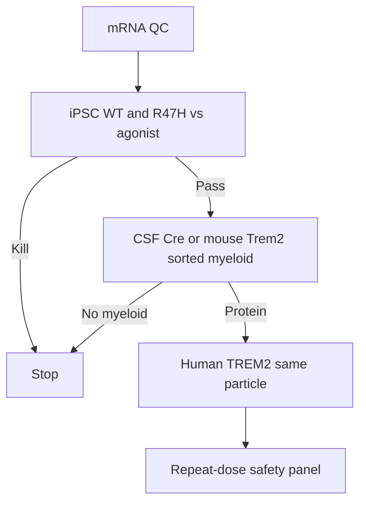

# Assays and decision numbers

Numbered notes point to [references.md](references.md). Safety package: [10-safety.md](10-safety.md).

## Cascade

Do not skip to Morris water maze.

## In vitro panel

| Assay | Platform | Pass (working) |
|---|---|---|
| mRNA integrity | CE | Intact ≥ 80% |
| Surface TREM2 | Flow, two clones if possible | ≥2× vs empty LNP *and* vs irrelevant mRNA |
| Total TREM2 / sTREM2 | ELISA or MSD | Report both; ratio matters |
| pSYK | After lipid ligand, washout | Up vs empty LNP[[4]](references.md) |
| Aβ phagocytosis | pHrodo Aβ | ≥50% vs empty LNP *and* vs agonist comparison on R47H / TREM2-low |
| Synapse eating | ePtdSer beads or synaptosomes | Must not outrun Aβ eating |
| Viability | ATP + Annexin | ≥70% of untreated |
| ISG | IFIT1, MX1, RSAD2 | Empty LNP subtracted[[8]](references.md) |

**Gated:** R47H or TREM2-low iPSC-microglia vs TREM2 agonist + empty LNP.[[2]](references.md) If agonist wins, stop.

## In vivo panel

| Assay | Pass |
|---|---|
| Sorted parenchymal myeloid protein | Vs vehicle, empty LNP, and MC3[[10]](references.md) |
| Reporter alone | Not sufficient for the TREM2 claim |
| ALT/AST | ≤3× vehicle unless histology is clean |
| Cytokines 2–6 h and 24 h | Document |
| Dose 2–3 anti-PEG + C3a/sC5b-9 + protein | Protein still there[[13]](references.md)[[15]](references.md) |
| PSD-95 / drebrin / engulfed PSD-95 | No drop at PD dose |
| Plaque compaction / clustering | Only after exposure *and* synaptic panel[[5]](references.md)[[11]](references.md) |
| Vessel-adjacent Prussian blue | No new microbleed signal |
| ISG on sorted myeloid after dose 3 | Not a storm |

## Out of scope until exposure exists

Cognition as primary. Multi-omics as a substitute for protein. NHP before mouse myeloid pass (NHP IT/ICM is triggered *after* CSF protein if CSF is the product).

## Controls

Vehicle. Empty LNP. Irrelevant mRNA LNP. MC3/SM-102 same cargo. TREM2 agonist on the dish wedge.[[16]](references.md)
