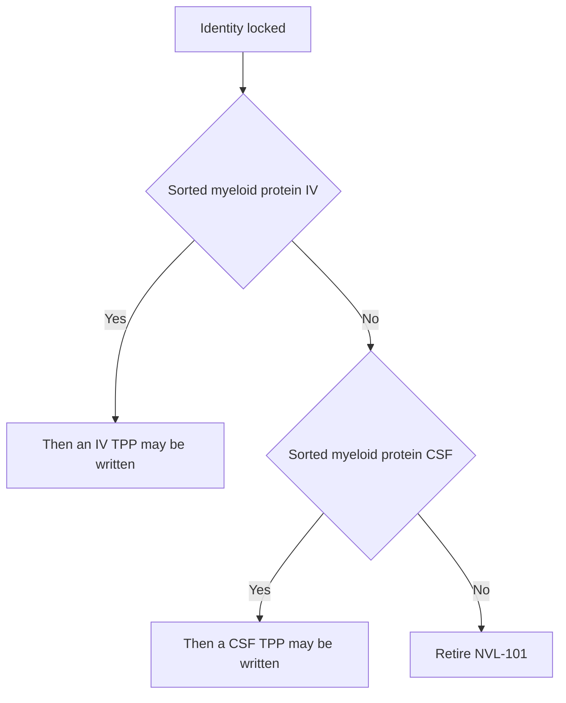

# Target product profile — NVL-101

Living document. **Minimal** = what must be true to stay in the program. **Ideal** = what we would take into a partner conversation after Phase 1 PD. Numbers are design goals until a protocol and a specification exist.

Citations: [references.md](references.md). Complement detail: [07-complement.md](07-complement.md). Language discipline: [08-adversarial-review.md](08-adversarial-review.md) §7.

No route is preferred until that diamond resolves. IV is the *commercial wish*. CSF is the *higher prior*. Neither is the product yet.

---

## 1. Identity and regulatory class

| Attribute | Minimal | Ideal |
|---|---|---|
| Code | NVL-101 | Same; INN later |
| Legal name placeholder | TREM2 mRNA lipid nanoparticle | Same |
| Modality | Non-replicating, non-integrating mRNA in an ionizable LNP | Same |
| Payload | Human WT TREM2 isoform 1 (NP_061838) | Same sequence; tighter UTR/process |
| Particle claim allowed now | Ionizable LNP; tropism unknown | Myeloid protein demonstrated, then name the tropism |
| Editor | None | None |
| Combination product | Drug only | Drug only (no FUS device) |
| US lead center | CBER (mRNA-LNP) | CBER; neurology consult |
| Designation intent | None at seed | Fast Track / orphan only if a genetic TREM2-disease wedge is added later |

Do not write “microglia-biased LNP” in any external sentence until sorted CNS myeloid protein exists.

Classification note: this is a **gene *material*** product (mRNA), not a gene *therapy* that alters the genome.

---

## 2. Indication and patient

Two nested populations. Do not treat them as the same TAM.

| Attribute | Genetically sharp (first scientific file) | Broader label ambition (only after PD in unselected myeloid biology) |
|---|---|---|
| Disease | Alzheimer’s disease | Same |
| Genetics | TREM2 R47H / other hypomorphic carriers[[1]](references.md)[[2]](references.md) | Unselected early AD |
| Stage | MCI or mild dementia due to AD | Same |
| Biomarker gate | Amyloid-positive (PET, CSF Aβ 42/40, or validated blood) | Same |
| Age | 50–85 | Same |
| Why this order | Copy-number is most falsifiable where receptor function is already short | Large channel is a payer story, not the first proof |

Excluded as index: moderate–severe dementia; pure tauopathies; NHD/PLOSL as the first file.[[7]](references.md)

Rationale for *early* stage: TREM2 effects on amyloid are stage-dependent in mice.[[3]](references.md)[[12]](references.md) That is a constraint, not evidence that early unselected AD is the launch population.

---

## 3. Mechanism claim we are allowed to make

**Internal hypothesis (not a label):** if the particle transfects the right cell, more WT TREM2 copy number may improve lipid sensing and plaque-associated function beyond occupancy of existing receptor.[[4]](references.md)

| After the matching data | Still not allowed |
|---|---|
| Product is TREM2 mRNA in an LNP | Microglia-biased, brain-penetrant, tropic |
| Increases TREM2 protein in transfected iPSC-microglia | Increases TREM2 on plaque-associated human microglia |
| Increases TREM2 on sorted mouse CNS myeloid cells | Human PD |
| Moves CSF sTREM2 *and* a second myeloid marker, with empty-LNP control | sTREM2 rise equals efficacy or target engagement |
| Transient if redose works | Permanent rewrite |

CSF sTREM2 is confounded by shedding, peripheral myeloid leak, and inflammation. It is a *candidate* marker, never a standalone PD claim.

Falsifier: WT mRNA in TREM2-low / R47H microglia does not beat agonist + empty LNP on surface receptor and pSYK/phagocytosis.

---

## 4. Target cell, route, regimen

| Attribute | Now | After a pass |
|---|---|---|
| Cell we *want* | Parenchymal plaque-associated microglia[[6]](references.md) | Same, if the particle actually hits them |
| Cell we may get | Homeostatic microglia, BAM, meningeal, Kupffer | Must be named if that is the product |
| Route | Undeclared. Test IV and CSF in parallel | Whichever produced sorted myeloid protein at a tolerable dose |
| IV | Commercial wish; hepatic prior is against it[[10]](references.md) | Outpatient infusion only if the IV arm passed |
| CSF (ICM / lumbar analog) | Higher prior for exposure; different human product | Primary TPP if IV failed |
| Out of scope | FUS+IV, intraparenchymal, nasal as primary | Same |
| Dose | Not set | Allometric from NOAEL and from the mouse dose that first moves *sorted-microglia TREM2 protein* |
| Interval | **Unknown.** Do not print 4–12 weeks | Set by protein decay in non-dividing myeloid cells after ≥2 in vivo doses, with anti-PEG measured[[15]](references.md) |
| Duration concept | Not set | Chronic intermittent only if interval and complement allow |

---

## 5. Pharmacodynamic and efficacy ladder

| Rung | Setting | Minimal pass | Ideal |
|---|---|---|---|
| 0 | mRNA QC | Integrity ≥ 80%, cap present | Same + dsRNA below a numbered spec |
| 1 | iPSC-microglia | ≥2× surface TREM2 vs empty LNP *and* vs irrelevant mRNA; phagocytosis and pSYK after ligand, agonist comparison | Same in R47H or TREM2-low[[2]](references.md) |
| 2 | Mouse delivery | TREM2 *protein* (not reporter alone) on FACS-sorted parenchymal myeloid cells; ALT/AST ≤3×; empty LNP subtracted | IV arm wins; otherwise declare CSF |
| 3 | Amyloid model, two ages | Compaction / clustering without synaptic-marker loss[[5]](references.md)[[11]](references.md)[[12]](references.md) | DAM transcripts as support only[[6]](references.md) |
| 4 | Phase 1 human | Safety. PD only if a pre-specified panel (not sTREM2 alone) moves | Panel plus imaging myeloid marker |
| 5 | Phase 2 | Biomarker with acceptable safety | Clinical slope secondary |

Cognition is not a Phase 1 endpoint.

---

## 6. Safety envelope

See [07-complement.md](07-complement.md).

| Risk | Minimal control | Kill / hold |
|---|---|---|
| Infusion / complement / PEG | Shedding PEG-lipid; slow infusion; anti-PEG and C3a/sC5b-9 on redose[[13]](references.md)[[14]](references.md)[[15]](references.md) | CARPA or ABC particle design cannot fix |
| Liver | ALT/AST; empty-LNP arm | Persistent >3× ULN with injury |
| Innate RNA | Modified nucleosides; dsRNA depletion[[8]](references.md)[[9]](references.md) | ISG storm at the PD dose |
| CNS edema | Histopathology; MRI if human | ARIA-like signal without a plan |
| Peripheral myeloid | Spleen, liver, bone[[7]](references.md) | Osteoclast or macrophage toxicity |
| Over-phagocytosis | Synaptic markers at the PD dose | PSD-95 / drebrin drop — ranked kill, even if plaques look better |

---

## 7–9. Presentation, QTPP, CMC

Unchanged in substance: frozen single-use vial; size 60–100 nm; PDI ≤ 0.2; encapsulation ≥ 80%; split CDMO. No multi-ligand conjugation in v1.

---

## 10. Competitive frame

| Class | What they do | What we must still prove |
|---|---|---|
| Anti-amyloid mAbs | Remove plaque; ARIA | Different cell; not assumed safer around CAA |
| TREM2 agonist mAb / oral | Occupancy | Copy number adds function in TREM2-low or variant cells |
| Other CNS LNPs | Often neuron/astrocyte | Sorted myeloid *protein*, not skull luciferase[[10]](references.md) |

---

## 11. Explicit non-goals and banned phrases

Non-goals: longevity; Cas9/HDR; BDNF multi-cistron; CD34/CD90/c-Kit ligands; Phase 3 cognition as a seed milestone; FUS as part of NVL-101; co-packaged complement inhibitor.

**Do not use until the matching rung exists:** microglia-biased; brain-penetrant; microglia-targeted; preferred IV route; q4–12 week dosing; CSF sTREM2 as proof of mechanism; launch population = all early AD.

---

## 12. Label-facing sentence

None at seed.

Draft only after rung 4, and only with the route that actually passed:

> NVL-101 is TREM2 mRNA in an LNP. Route and interval TBD from myeloid protein kinetics. Intended, if data allow, to raise TREM2 on CNS myeloid cells in amyloid-positive early AD, with TREM2-hypomorphic carriers as the first genetic slice.
