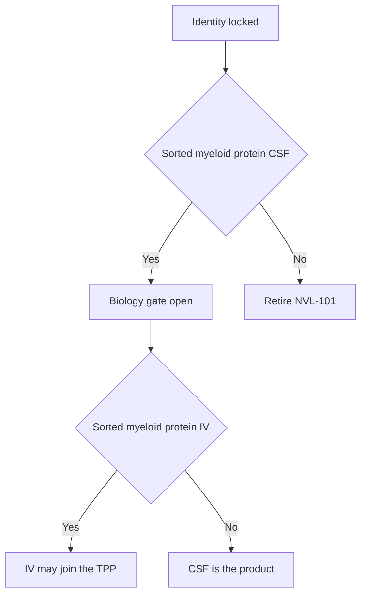

# Target product profile — NVL-101

Living document. **Minimal** = what must be true to stay in the program. **Ideal** = after Phase 1 PD. Citations: [references.md](references.md). Complement: [07-complement.md](07-complement.md). Safety deep-dive: [10-safety.md](10-safety.md). Language: [08-adversarial-review.md](08-adversarial-review.md) §7. Operating plan: [09-solutions-1-3.md](09-solutions-1-3.md).

CSF is the PD-enabling route. IV is a commercial option. Neither is claimed until protein exists.

---

## 1. Identity and regulatory class

| Attribute | Minimal | Ideal |
|---|---|---|
| Code | NVL-101 | Same; INN later |
| Legal name placeholder | TREM2 mRNA lipid nanoparticle | Same |
| Modality | Non-replicating, non-integrating mRNA in an ionizable LNP | Same |
| Payload | Human WT TREM2 isoform 1 (NP_061838) | Same sequence |
| Particle claim allowed now | Ionizable LNP; tropism unknown | Myeloid protein demonstrated |
| Editor | None | None |
| Combination product | Drug only | Drug only |
| US lead center | CBER (mRNA-LNP) | CBER; neurology consult |

Do not write “microglia-biased LNP” until sorted CNS myeloid protein exists.

---

## 2. Indication and patient

| Attribute | Genetically sharp (first file) | Broader ambition (after unselected PD) |
|---|---|---|
| Disease | Alzheimer’s disease | Same |
| Genetics | TREM2 R47H / hypomorphic carriers[[1]](references.md)[[2]](references.md) | Unselected early AD |
| Stage | MCI or mild dementia due to AD | Same |
| Biomarker | Amyloid-positive | Same |
| Age | 50–85 | Same |

Exclude moderate–severe dementia, pure tauopathies, NHD as the first file.[[7]](references.md) APOE ε4/ε4 is a **safety** handling issue after AL002, not a default include.[[16]](references.md)

---

## 3. Mechanism language

Hypothesis only: more WT copy number in receptor-low cells may beat occupancy.[[4]](references.md) AL002 occupied TREM2, moved CSF markers, missed CDR-SB.[[16]](references.md)

Falsifier: WT mRNA in R47H / TREM2-low microglia does not beat agonist + empty LNP.

sTREM2 is never standalone PD.

---

## 4. Cell, route, regimen

Wanted cell: parenchymal plaque-associated microglia.[[6]](references.md) May get homeostatic / BAM / Kupffer — name it if so.

Route undeclared until protein. CSF = higher prior. IV = wish. Interval unknown; set by ≥2-dose protein curve + anti-PEG.[[15]](references.md)

---

## 5. Ladder

0 QC → 1 iPSC WT **and** R47H vs agonist → 2 CSF sorted protein (IV recorded) → 3 amyloid two ages **without** synaptic loss → 4 human safety + pre-specified panel ≠ sTREM2 alone → 5 biomarker Phase 2.

---

## 6. Safety envelope

Full text: [10-safety.md](10-safety.md).

| Risk | Control | Kill / hold |
|---|---|---|
| Synapses | PSD-95, drebrin, engulfed PSD-95 at PD dose[[17]](references.md) | Drop at PD dose — ranked kill |
| Complement / PEG / ABC | Shedding PEG; anti-PEG + C3a on dose 2[[13]](references.md)[[14]](references.md)[[15]](references.md) | CARPA or lost protein on redose |
| Liver / bone / spleen | Histology on first repeat-dose[[7]](references.md) | Osteoclast or Kupffer injury on the surviving route |
| ARIA-like / CAA | Vessel Prussian blue; human MRI concept; no anti-amyloid combo FIH[[16]](references.md) | Edema or microbleed signal without a plan |
| Interferon | ISG dose 1 and 3; empty LNP subtracted[[8]](references.md) | Storm at the PD dose |

---

## 7–9. Presentation, QTPP, CMC

Frozen single-use vial. 60–100 nm. PDI ≤ 0.2. Encapsulation ≥ 80%. Split CDMO. No ligands in v1.

---

## 10. Competitive frame

Anti-amyloid mAbs: plaque + ARIA. TREM2 agonists: occupancy that already failed a Phase 2 primary.[[16]](references.md) Other CNS LNPs: often wrong cell.[[10]](references.md)

---

## 11. Banned phrases until the matching rung

Microglia-biased; brain-penetrant; preferred IV; q4–12 week; sTREM2 as proof; launch = all early AD.

---

## 12. Label sentence

None at seed.
