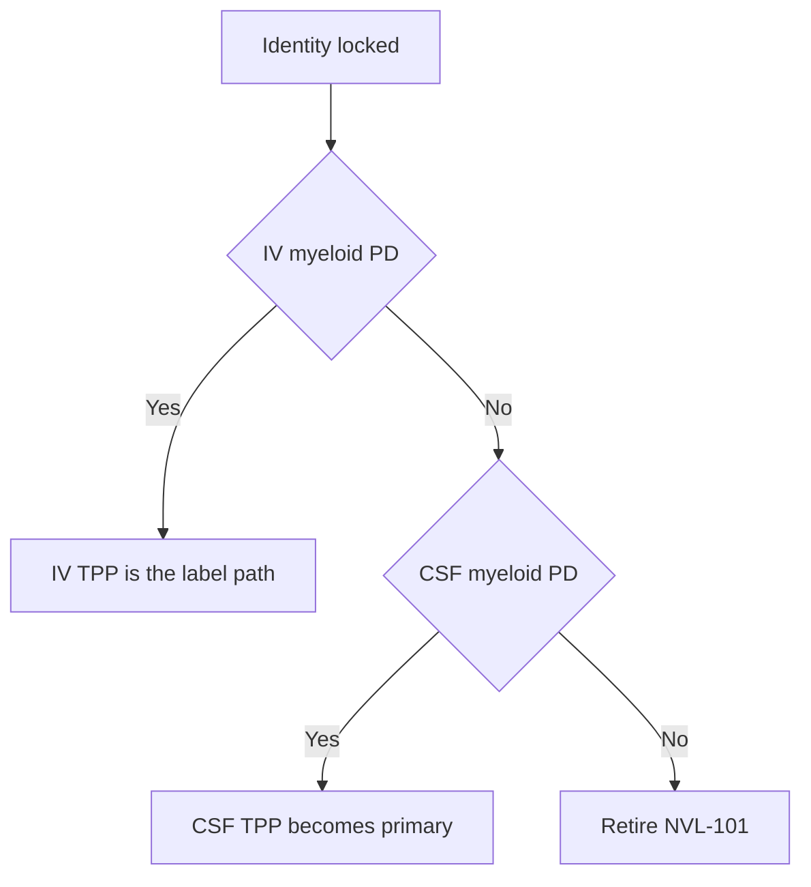

# Target product profile — NVL-101

Living document. **Minimal** = what must be true to stay in the program. **Ideal** = what we would take into a partner conversation after Phase 1 PD. Numbers are design goals until a protocol and a specification exist.

Citations: [references.md](references.md).

---

## 1. Identity and regulatory class

| Attribute | Minimal | Ideal |
|---|---|---|
| Code | NVL-101 | Same; INN later |
| Legal name placeholder | TREM2 mRNA lipid nanoparticle | Same |
| Modality | Non-replicating, non-integrating mRNA in an ionizable LNP | Same |
| Payload | Human WT TREM2 isoform 1 (NP_061838) | Same sequence; tighter UTR/process |
| Editor | None | None |
| Combination product | Drug only | Drug only (no FUS device) |
| US lead center | CBER (mRNA-LNP) | CBER; neurology consult |
| Designation intent | None at seed | Fast Track / orphan only if a genetic TREM2-disease wedge is added later — **not** the AD plan |

Classification note: this is a **gene *material*** product (mRNA), not a gene *therapy* that alters the genome. Do not describe it as CRISPR, AAV, or cell therapy in any filing language.

---

## 2. Indication and patient

| Attribute | Minimal | Ideal |
|---|---|---|
| Disease | Alzheimer’s disease | Same |
| Stage for first label ambition | Early AD / MCI due to AD | Prodromal + mild AD |
| Biomarker gate | Amyloid-positive (PET or CSF Aβ 42/40) | Amyloid+ and evidence of microglial engagement (CSF sTREM2 or TSPO/other) |
| Genetics | Unselected early AD | Enrichment arm for TREM2 R47H / hypomorphic carriers[[1]](references.md)[[2]](references.md) |
| Age | 50–85 | Same |
| Background SoC | Stable acetylcholinesterase inhibitor / memantine allowed | Stable anti-amyloid mAb allowed after drug–drug and ARIA risk is written down |
| Excluded | Moderate–severe dementia as index population; pure tauopathies; NHD/PLOSL as the first file[[7]](references.md) | Same |

Rationale: TREM2 biology is stage-dependent in amyloid models.[[3]](references.md)[[12]](references.md) Compaction and DAM programs matter while plaques are being contained.[[5]](references.md)[[6]](references.md) Late symptomatic AD is a different bet.

---

## 3. Mechanism claim we are allowed to make

**Internal hypothesis (not a label):** NVL-101 raises TREM2 *copy number* on CNS myeloid cells so more receptor is available for lipid / debris sensing and plaque-associated function.[[4]](references.md)

| What we may say after data | What we may not say |
|---|---|
| Product delivers TREM2 mRNA | Cures AD |
| Increases TREM2 protein in transfected microglia (preclinical) | Restores cognition |
| Moves CSF sTREM2 (if seen) | Replaces anti-amyloid antibodies |
| Transient, redosable | Permanent genome rewrite |

Agonist antibodies and oral agonists occupy receptor that is already there. This TPP is only interesting if copy-number adds something those agents cannot.

---

## 4. Target cell, route, regimen

| Attribute | Minimal | Ideal |
|---|---|---|
| Cell | CNS microglia / CNS-associated myeloid | Preferentially plaque-associated / DAM-like microglia[[6]](references.md) |
| Off-cell | Neurons and astrocytes not the PD cell | Off-cell transfection quantified and low |
| Preferred route | IV infusion | IV, 30–120 min, outpatient infusion center |
| Acceptable route | CSF (ICM preclinical; lumbar IT as human analog) | Lumbar IT only if IV myeloid/liver ratio is hopeless |
| Out of scope | FUS+IV, intraparenchymal, nasal as primary | Same |
| Starting dose logic | Allometric from NOAEL and from the mouse dose that first moves sorted-microglia TREM2 | Same, plus empty-LNP cytokine ceiling |
| Frequency | Redose set by protein decay, not by vaccine schedules | Every 4–12 weeks if PD lasts weeks |
| Treatment duration (concept) | Chronic intermittent | Same; stop rules on ARIA-like MRI, LFTs, complement |

IV is the commercial path. CSF is a scientific control and a fallback TPP, not a secret second product.

---

## 5. Pharmacodynamic and efficacy ladder

Success is staged. Do not promote a later rung before the earlier rung exists.

| Rung | Setting | Minimal pass | Ideal |
|---|---|---|---|
| 0 | mRNA QC | Integrity ≥ 80%, cap present | Same + dsRNA below a numbered spec |
| 1 | iPSC-microglia | ≥2× surface TREM2 vs empty LNP; ≥50% relative phagocytosis gain | Same in an R47H or TREM2-low line[[2]](references.md) |
| 2 | Mouse delivery | Sorted microglia reporter or TREM2 protein at a dose with ALT/AST ≤3× vehicle | IV path wins; CSF reserved as control |
| 3 | Amyloid model | Directional plaque-associated microglia / compaction after exposure is proven[[5]](references.md)[[11]](references.md) | Quantified plaque morphology + DAM transcripts[[6]](references.md) |
| 4 | Phase 1 human | Safety + any on-mechanism CSF movement | CSF sTREM2 rise without runaway inflammation |
| 5 | Phase 2 | Biomarker (amyloid PET or CSF) with acceptable safety | Clinical slope on CDR-SB or similar as secondary |

Cognition is **not** a Phase 1 endpoint and is not a seed claim.

---

## 6. Safety envelope

| Risk | Minimal control | Kill / hold |
|---|---|---|
| Infusion / complement / PEG antibodies | Slow infusion; premed policy TBD; anti-PEG Ig monitoring in repeat-dose animals | Anaphylactoid pattern or complement that cannot be managed |
| Liver | ALT/AST protocol limits; empty-LNP arm | Persistent >3× ULN with injury |
| Innate RNA sensing | Modified nucleosides; dsRNA depletion[[8]](references.md)[[9]](references.md) | ISG storm at the PD dose |
| CNS inflammation / edema | MRI protocol if human; mouse histopathology | ARIA-like signal without a mitigation plan |
| Off-cell TREM2 in periphery | Biodistribution panel including spleen, liver, bone[[7]](references.md) | Unexpected osteoclast or macrophage toxicity |
| Over-phagocytosis | Synapse markers only after exposure pass | Clear synaptic loss at PD dose |

---

## 7. Presentation, storage, use

| Attribute | Minimal (GLP / early GMP) | Ideal (commercial sketch) |
|---|---|---|
| Dosage form | Sterile dispersion for injection or infusion | Same |
| Container | Single-use vial | Vial + closed-system transfer |
| Strength | Set after mouse PD dose; do not invent mg/mL now | Unit dose covering one visit |
| Storage | Frozen (≤ −20 °C or −70 °C) acceptable | 2–8 °C ≥ 3 months would be a CMC win, not a seed requirement |
| In-use | Thaw once; no refreeze; limited room-temp window | 4–8 h after thaw |
| Diluent | Compatible with standard IV bags if IV path | Same |
| Visual | Opalescent, no visible particles beyond LNP scatter | Same |

---

## 8. Quality target product profile (QTPP)

These become specification rows later. At seed they are process aims.

| CQA | Aim | Why |
|---|---|---|
| Identity, RNA | TREM2 CDS matches template (NGS or equivalent) | Wrong ORF is a different drug |
| Integrity | ≥ 80% full-length by CE | Fragments do not make receptor |
| Capping | Cap 1; % capped reported | Translation + innate profile |
| polyA length | 80–120 nt, distribution reported | Stability |
| dsRNA | Below immunoassay limit (set with CDMO) | Cytokines[[8]](references.md) |
| Encapsulation | ≥ 80% | Free RNA is the wrong product |
| Size | 60–100 nm z-average | Biodistribution |
| PDI | ≤ 0.2 | Process control |
| Charge / pKa | Recorded per composition | Screen variable, then freeze |
| Residual solvent | Ethanol within parenteral limit | Safety |
| Endotoxin | USP parenteral at GMP; research-grade numbered before that | Innate confound |
| Bioburden / sterility | Sterile at DP | Parenteral |
| Lipid impurities | Identified after composition freeze | FTO + tox |
| Empty particle fraction | Reported | Safety vs potency |

Composition freeze rule: no multi-ligand conjugation in v1. One lipid library. One payload.

---

## 9. CMC posture (how the TPP is made)

| Step | Seed posture |
|---|---|
| mRNA DS | TriLink or Aldevron; ψ-modified; dsRNA depleted |
| LNP DP | Lonza / Cytiva-PNI / Catalent / Polymun; microfluidic mix |
| Lipids | Licensed or catalog; FTO memo before IND-enabling spend |
| Fill/finish | Separate sterile shop |
| Release | Split COAs; company owns the specification |

No single end-to-end CDMO requirement.

---

## 10. Competitive frame the TPP must survive

| Class | What they do | NVL-101 difference we must prove |
|---|---|---|
| Anti-amyloid mAbs | Remove plaque; ARIA | Different cell and mechanism; possible combo later |
| TREM2 agonist mAbs | Cluster existing receptor | Copy number vs occupancy |
| Oral TREM2 agonists | Brain-penetrant occupancy | Same occupancy problem |
| Other CNS LNPs | Often neuron/astrocyte | Myeloid protein, not skull luciferase[[10]](references.md) |

If we cannot beat “just agonize” in a TREM2-low or variant microglia assay, the TPP collapses even if delivery works.

---

## 11. Explicit non-goals (keep the file honest)

- Longevity or telomere claims
- Genomic knock-in, HDR, Cas9
- BDNF or multi-cistron payloads in v1
- Stem-cell surface targeting (CD34 / CD90 / c-Kit)
- Phase 3 cognitive superiority as a seed milestone
- Device-enabled BBB opening as part of NVL-101

---

## 12. Label-facing sketch (aspirational, post-human PD only)

One sentence we would *want* after Phase 2, not what we have:

> NVL-101 is a TREM2 mRNA-LNP for early, amyloid-positive Alzheimer’s disease, dosed intravenously on an intermittent schedule, intended to increase microglial TREM2 and support plaque-associated myeloid function.

Until Phase 1 PD exists, that sentence stays in this file and off slides that imply human benefit.
