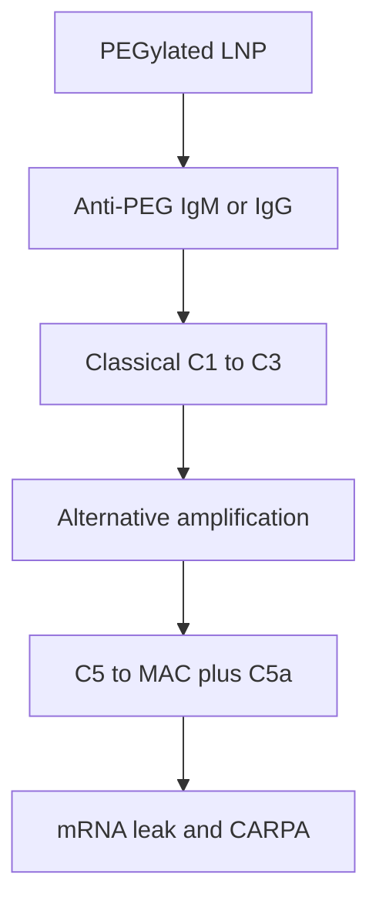

# Complement and PEGylated LNPs

Not an Alzheimer’s mechanism. This is infusion safety and particle integrity for IV NVL-101. Numbered notes: [references.md](references.md).

## Two clinical pictures

**CARPA** can appear on first exposure. Nanoparticles and PEGylated liposomes activate complement; C3a and C5a drive an anaphylactoid reaction that is not IgE allergy.[[14]](references.md)

**ABC** appears on later doses. mRNA-LNPs can trigger early B-1 (anti-phosphorylcholine IgM) then B-2 (anti-PEG) responses; subsequent doses clear faster into liver and spleen.[[15]](references.md)

Anti-PEG antibody plus human serum deposits C3 on PEGylated liposomes and mRNA-LNPs, correlates with donor anti-PEG IgM, and can **release encapsulated mRNA**. An anti-C5 antibody (eculizumab) blocked that release in vitro. Complement is therefore a safety issue and a potency issue.[[13]](references.md)

Classical pathway starts the anti-PEG event; alternative-pathway amplification helps lyse the particle.[[13]](references.md)

## Layer 1 — particle (seed default)

| Lever | Evidence-based aim |
|---|---|
| PEG-lipid anchor | Prefer a shedding C14-class PEG-lipid unless tropism forbids it. Long-stay C18 PEG keeps presenting antigen. |
| PEG mol % | Screen 0.5–2.5%. Vaccine-like ~1.5% is the starting band; 5% DSPE-PEG historically maximized ABC in liposomes. |
| Empty particles | Extra surface, extra C3. Already a QTPP row in [06-target-product-profile.md](06-target-product-profile.md). |
| Charge | Record zeta and PEG-lipid phosphate; anionic headgroups can feed complement. |

MC3 four-component LNPs remain the clinical baseline for nucleic-acid LNPs, not proof of microglia tropism.[[10]](references.md)

## Layer 2 — administration

- Slow infusion and dilution reduce pig-model pulmonary hypertension from complement versus bolus (liposome CARPA literature).[[14]](references.md)
- Empirical premeds (corticosteroid, H1 ± H2) blunt symptoms; they do not replace C3a / sC5b-9 or anti-PEG titers.
- Redose on a weeks-to-months cadence, not a weekly vaccine cadence.[[15]](references.md)
- Measure anti-PEG IgM/IgG before dose 1 and before each redose. Donor IgM tracked LNP complement attack in vitro.[[13]](references.md)

Free high-MW PEG as a competitive decoy is preclinical only. Not a Phase 1 plan.

## Layer 3 — pharmacologic blockade (contingency)

Do not co-package a complement drug with NVL-101. These agents are approved for PNH, aHUS, C3G, IgAN, myasthenia, NMOSD, vasculitis — not for LNP prophylaxis. Terminal-pathway blockade requires meningococcal vaccination and carries infection risk.

| Target | Example class | LNP rationale | Seed use |
|---|---|---|---|
| C5 | eculizumab / ravulizumab | Blocked anti-PEG–driven mRNA release in vitro[[13]](references.md) | Assay reagent; possible future rescue arm only |
| C3 / C3b | pegcetacoplan | Amplification hub | Not a premed; the drug is itself PEGylated |
| Factor B | iptacopan | Alternative-path amplification | Oral C3G/IgAN drug; not an LNP partner |
| C1s | sutimlimab | Closest to “stop classical start” | No nanoparticle label |
| C5aR | avacopan | Symptom, not lysis | Vasculitis |

## Seed assays (add to the cascade)

1. Human serum ± anti-PEG IgM: C3b/c, sC5b-9, and mRNA leak versus empty LNP.[[13]](references.md)
2. C14 vs C18 PEG-lipid on the same ionizable lipid.
3. Repeat-dose mouse: anti-PEG IgM, second-dose liver shift, cytokines.[[15]](references.md)
4. Human protocol sketch: slow infusion, anti-PEG titers, C3a/C5a around infusions 1 and 2.[[14]](references.md)

## Non-goals

- Complement inhibitor inside the particle
- Systemic C5 blockade as standard premed in early AD
- Assuming CSF dosing avoids complement biology in plaque-bearing cortex
