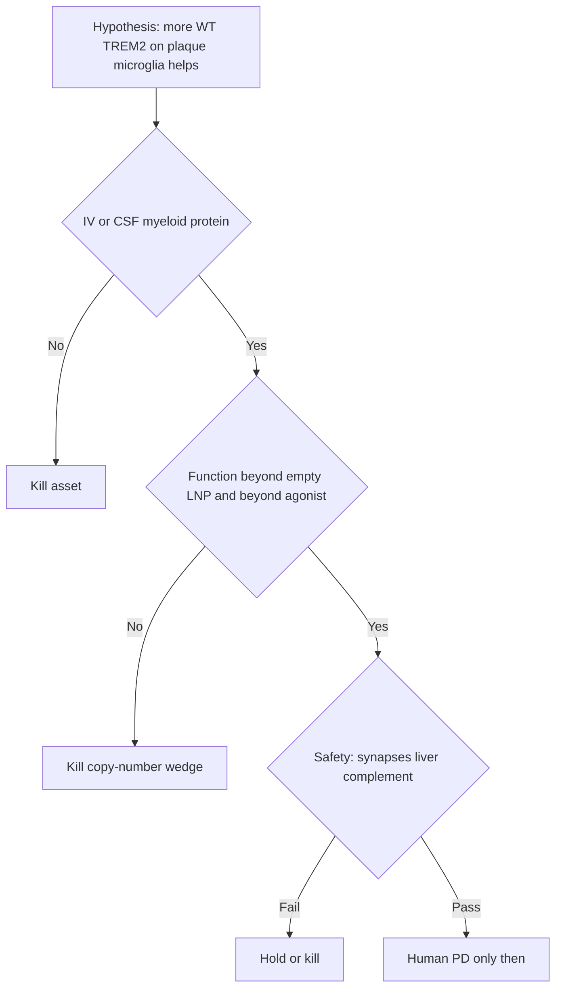

# Adversarial scientific review — NVL-101

Scope: biology, construct, delivery, assays, models, TPP claims. Not team, address, tooling, or fundraising style.

Stance: assume the package is wrong until a specific experiment forces a revision. Citations: [references.md](references.md).

---

## Verdict

The target is genetically real. The *product* is not. NVL-101 is two unsolved problems stacked: (1) get mRNA into *plaque-associated microglia in an aged, amyloid brain* at a dose the liver and complement system tolerate, and (2) prove that extra TREM2 protein does something agonist antibodies cannot. The package names both problems. It does not have data that either is solvable. Until sorted-microglia protein exists, this is a hypothesis with a manufacturing plan.

---

## 1. Delivery is the binary, and the prior is ugly

Standard ionizable LNPs after IV go to liver. That is the Onpattro lesson, not a footnote.[[10]](references.md) A 20–40 composition screen is not a strategy; it is a lottery ticket against decades of hepatic tropism.

Attacks the file underweights:

- **Access ≠ tropism.** Endothelium, choroid, and meningeal macrophages can light up a “brain” homogenate or an IVIS skull. None of those cells is the DAM niche. The package says this. Reviewers will still be shown whole-brain luciferase in a rush. Treat any non-sorted signal as contamination.
- **Aged, plaque-bearing BBB is not C57BL/6J at 8 weeks.** Delivery pass in young WT mice does not transfer to 5xFAD or to a 72-year-old with CAA. If the only myeloid hit is CSF in a young mouse, the commercial IV TPP is already dead and the human procedure risk has not been priced scientifically (IT injury, distribution to lumbar vs cisternal territories).
- **Ligand-free v1 is honest and probably insufficient.** Mannose / CD11b as “v1.1” is a hope. Surface ligands on LNPs change protein corona, complement, and clearance — they do not magically cross endothelium.
- **Dose that reaches parenchyma may be a cytokine dose.** Empty-LNP subtraction is mandatory and still imperfect: the same particle that transfects microglia will activate them. A DAM-like RNA-seq signature after LNP is not TREM2 pharmacology.[[8]](references.md)

**Kill if:** no increase in TREM2 protein on *sorted* CNS myeloid cells at ALT/AST ≤3× and without an ISG storm. Do not negotiate this number after the first ugly PK plot.

---

## 2. The copy-number wedge may be empty

Genetics say *loss* of TREM2 function increases AD risk.[[1]](references.md)[[2]](references.md) That does not imply *more than endogenous WT* is better. Plaque-associated microglia already upregulate TREM2 as they enter DAM.[[6]](references.md) The cells you most want may already be TREM2-high. Extra WT copies on homeostatic microglia (easier to transfect, wrong state) could be the actual product.

Worse:

- **Agonists occupy the same pathway.** If AL002-class antibodies fail or plateau, the pathway—not the occupancy mode—may be the limit. Copy number does not rescue a ligand-poor or DAP12-saturated cell.
- **R47H is a trafficking / ligand-binding defect, not a simple dosage problem.** Putting more WT mRNA into a mixed population is only clean if variant cells are transfected and the WT protein reaches the surface. The package marks R47H iPSC lines as “if timely.” That experiment *is* the wedge. Without it, you have generic myeloid activation.
- **sTREM2.** More surface receptor means more shed ectodomain. sTREM2 is used as PD and may act as a decoy. You cannot claim engagement and ignore the sink. Measure both; do not celebrate a CSF sTREM2 bump as efficacy.
- **Stage dependence is not a footnote.** TREM2 deficiency has looked protective early and harmful later in amyloid mice.[[3]](references.md)[[12]](references.md) Raising TREM2 in the wrong window could enlarge plaques or inflammatory damage. One age in 5xFAD is not a program.

**Falsifier the TPP should print in bold:** WT mRNA in TREM2-low / R47H microglia does not beat an agonist plus empty LNP on phagocytosis and pSYK.

---

## 3. Construct risks that are not “CMC later”

- Human TREM2 in mouse microglia is a species mismatch for pairing, glycosylation, and antibody reagents. A “pass” with anti-human ectodomain in mouse may miss mouse protein displacement or DAP12 occupancy. Run a mouse Trem2 mRNA arm in the delivery mouse or use humanized Trem2 mice before claiming in vivo PD.
- Isoform 1 only. TREM2 has isoforms; you have not shown isoform 1 is the plaque isoform that matters.
- DAP12 “is abundant” is an assumption. If adaptor is limiting in DAM, extra TREM2 is orphan receptor and more sTREM2.
- Kinetics: 5–10 day decay in dividing iPSC cultures is not the resident microglia half-life. Redose could be weekly (complement + ABC) or uselessly rare. Protein persistence in non-dividing microglia is unknown and is the whole commercial interval.[[15]](references.md)
- N1-methylpseudouridine reduces TLR sensing; it does not zero it, and it can alter translation fidelity. Controls must include unmodified vs modified at the same encapsulation.[[8]](references.md)[[9]](references.md)

---

## 4. Assays can launder a weak effect

| Stated pass | Attack |
|---|---|
| ≥2× surface TREM2 MFI | Easy to hit with a sticky antibody and a slightly healthier cell. Require a second clone, a knockout-subtracted gate, and a quantitative ELISA on the same wells. |
| ≥50% phagocytosis vs empty LNP | iPSC-microglia eat beads when mildly activated by the LNP. Use empty LNP *and* irrelevant mRNA. Prefer fibrillar Aβ and synapse-associated material as a toxicity read, not only pHrodo Aβ. |
| pSYK up | Innate LNP signaling phosphorylates everything. Lipid ligand stimulation after washout is the only interpretable pSYK. |
| Sorted microglia reporter | Reporter ≠ TREM2 folding and surface traffic. |
| Plaque area down | Can reflect toxicity and synapse loss. Require dystrophic-neurite and synaptic-marker panels *before* cheering 6E10.[[5]](references.md) |

Cognition as “exploratory” is correct. Using 5xFAD behavior as a partner slide would be scientific malpractice.

---

## 5. Models will flatter you

- iPSC-microglia are developmental, not DAM. They lack the plaque niche, myelin lipid load, and aged chromatin that define the human target cell.[[6]](references.md)
- 5xFAD is an amyloid storm, not AD. Compaction phenotypes can move without predicting human slope.[[11]](references.md)
- No tau. If TREM2’s human value is against neuritic tau, amyloid-only mice cannot show it.
- No NHP before mouse pass is fiscally rational and regulatorily thin if the route becomes IT/ICM. CSF products get asked about dorsal-root and brainstem exposure. That gap is scientific, not operational.
- Sex and APOE are missing. Human TREM2 risk and microglial state interact with APOE. A C57-only screen can pick a particle that fails in APOE4 myeloid cells.

---

## 6. Safety biology that can kill a “clean” PD

- **Synapses.** TREM2 participates in developmental pruning logic. Over-phagocytosis is in the TPP as a hold. It should be a ranked kill: if PSD-95 / drebrin drop at the PD dose, stop even if plaques look prettier.
- **Peripheral myeloid.** IV LNP will hit Kupffer cells, spleen, and osteoclast-lineage cells. Nasu–Hakola reminds you the axis is not brain-only.[[7]](references.md) Bone and liver histology belong on the first repeat-dose study, not on the IND wish list.
- **Complement vs cargo.** Anti-PEG IgM can breach PEGylated mRNA-LNPs; eculizumab blocked leak in vitro.[[13]](references.md)[[14]](references.md) A “PD miss” after dose 2 may be ABC, not biology.[[15]](references.md) If you only assay dose 1, you will publish a lie.
- **ARIA-adjacent edema.** Forcing myeloid activity around CAA-laden vessels is not guaranteed to be safer than anti-amyloid mAbs. MRI in mice is weak; vascular amyloid models are the honest next step after a 5xFAD compaction hint.
- **Interferon.** Chronic intermittent ISG in microglia is a disease model of its own. Subtracting empty LNP once does not clear a six-dose regimen.

---

## 7. TPP language that overreaches the evidence

**Status: addressed in TPP v after 2026-09-28 edit.** The five smuggled claims are now banned phrases in [06-target-product-profile.md](06-target-product-profile.md) §11 and rewritten in the brief and opportunity file.

| Old language | Replacement |
|---|---|
| Microglia-biased LNP | Ionizable LNP; tropism is a screen goal |
| IV preferred | Route undeclared until sorted myeloid protein |
| 4–12 week redose | Interval unknown; set by in vivo protein decay after ≥2 doses |
| CSF sTREM2 as human PD | Candidate marker only; never standalone |
| Launch = all early AD | Genetically sharp slice first: TREM2 hypomorphic carriers |

Re-open this section if those phrases return on slides.

---

## 8. What would make a skeptic stand down

In order. Skip none.

1. Human iPSC-microglia: surface TREM2 and phagocytosis beat empty LNP, irrelevant mRNA, *and* a TREM2 agonist at a non-toxic dose; same in an R47H or TREM2-low line.
2. Mouse: human *or* species-matched TREM2 protein in FACS-sorted parenchymal microglia after IV *or* a pre-declared CSF fallback, with liver/cytokine within bounds, empty-LNP subtracted.
3. Repeat dose 2–3: protein still there; anti-PEG IgM measured; no cargo-leak pattern.[[13]](references.md)
4. One amyloid model, two ages: compaction / clustering without synaptic loss.[[5]](references.md)[[12]](references.md)
5. Only then talk about human CSF or PET-myeloid markers.

If step 2 fails, retire NVL-101. Do not add BDNF, Cas9, or stem-cell ligands.

---

## 9. Scorecard (pre-data)

| Claim | Scientific status |
|---|---|
| TREM2 loss increases AD risk | Strong[[1]](references.md)[[2]](references.md) |
| TREM2 supports plaque-associated microglia | Strong in mice[[4]](references.md)[[5]](references.md)[[6]](references.md) |
| More WT protein beats agonism | Unsupported |
| IV LNP transfects those microglia safely | Unsupported; prior against[[10]](references.md) |
| CSF route rescues tropism | Plausible, commercially and procedurally different drug |
| Transient mRNA matches chronic AD | Open; may require frequent redose and ABC[[15]](references.md) |
| iPSC + 5xFAD predict human PD | Weak[[11]](references.md) |
| Complement is manageable by PEG choice | Testable; not shown[[13]](references.md) |

**Bottom line:** keep the kill criteria. The science that exists supports *studying* TREM2. It does not support believing NVL-101 works.
