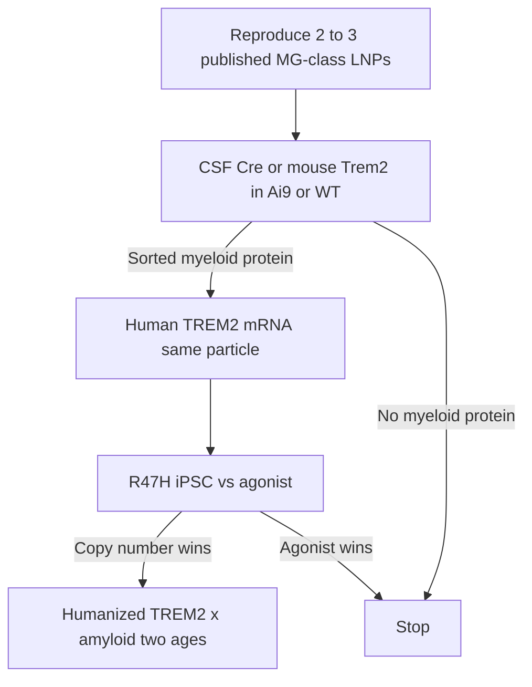

# Solutions for red-team items 1–3

Purpose: raise P(technical pass) and P(a CBER path that survives AL002). Not new payloads. Not ligands on HSCs. Complements [08-adversarial-review.md](08-adversarial-review.md).

Context that changes item 2: AL002 (TREM2 agonist mAb) Phase 2 in early AD missed CDR-SB and produced ARIA-like MRI despite CSF target engagement (*Nat Med* 2026). Occupancy of existing TREM2 is no longer an untested alternative. Copy-number must be *different*, or this class is cold.

---

## 1. Delivery

### What raises technical odds

**Declare CSF the PD-enabling route.** IV stays in the screen as a commercial option, not as the thing that can kill the biology. MIT MG-LNP work: the same particle transfected microglia far better from CSF than from the body, with less off-organ hit. That is the prior to copy, not Onpattro IV. Use ICM in mouse as the exposure assay; treat lumbar IT as the human analog you will have to defend.

**Do not invent a 40-lipid library from zero.** In-license or reproduce 2–3 published microglia-competent compositions (MG-LNP class; EV-mimetic helper-lipid hits that transfected microglia in Ai9/Cre screens; one furan/THF CNS LNP only if materials are available). Keep MC3/SM-102 as negative/hepatic controls. A small, high-prior set beats a random ionizable raffle.

**Score cells, not skulls.** Delivery pass = TREM2 or Cre protein in FACS-sorted *parenchymal* CD11b+ P2RY12+ (or equivalent) cells. Ai9/Cre or humanized-TREM2 mice for the first in vivo pass so you are not reading human protein with the wrong antibody.

**Age and amyloid in the *delivery* screen, not only in the efficacy screen.** One cohort of 5xFAD or APP mice at a plaque-bearing age. Young C57 pass is necessary and insufficient.

**Empty LNP and cytokine ceiling on every composition.** The winning particle is the one that still shows myeloid protein after you subtract innate activation.

### What raises regulatory odds

- Pre-IND *after* mouse CSF myeloid protein, *before* spending on IV heroics. Ask CBER: CSF-administered mRNA-LNP, what tox species and what DRG/brainstem package.
- If CSF is the product, budget a cynomolgus IT/ICM range-finder earlier than the old TPP implied. That is the tax for a route FDA has seen (Spinraza-class thinking), not a surprise.
- Do not add antibody ligands in v1. Each ligand is a new CQA, a new immunogen, and a combination-product argument. Composition tropism only.
- Write the IV failure memo in advance so a CSF TPP does not look like a pivot under duress.

### Do not do

FUS, nasal-as-primary, four-ligand surfaces, or calling a meningeal-lymphatic IV trick “brain delivery” without sorted parenchyma.

---

## 2. Copy-number wedge

### What raises technical odds

**Make R47H / TREM2-low iPSC-microglia a gated experiment, not “if timely.”** The wedge is: WT mRNA restores surface receptor and ligand-driven pSYK/phagocytosis in cells where endogenous TREM2 is weak, and beats agonist + empty LNP. If that fails, stop. Human TREM2 R47H iPSC lines exist; use them.

**Head-to-head vs agonism in the dish.** Include a TREM2 agonist antibody (AL002-class surrogate if obtainable) on the same cells. After AL002’s Phase 2 miss, “we are different because mRNA” is not a reason. Difference must be *functional in TREM2-low cells*.

**In vivo, use a human TREM2 context.** Options, in order of cleanliness:
1. Human common-variant TREM2 BAC on mouse Trem2-null, vs human R47H BAC on Trem2-null, on a 5xFAD background (Colonna-style models).
2. Trem2*R47H humanized-splice-site KI (avoids the cryptic-splice dosage artifact of older KI lines) ± APOE4 if a MODEL-AD cross is practical.
3. Mouse Trem2 mRNA in WT mice only as a *delivery* tool, not as AD pharmacology.

**Two ages in one amyloid model.** Early and later plaque burden. Stage dependence is how this target already lied once.

**sTREM2 as a ratio.** Report surface TREM2 / sTREM2 / osteopontin-class myeloid markers together. AL002 *lowered* CSF sTREM2 (occupancy/shedding). mRNA should *raise* surface protein and may raise sTREM2. If you only raise sTREM2, you may have built a decoy, not a receptor.

**Synaptic markers on the same slides as compaction.** After AL002 ARIA-like MRI, “microglial activation around vessels” is a class risk. A prettier 6E10 with lost PSD-95 is a kill.

### What raises regulatory odds

- First clinical genetics story = TREM2 hypomorphic carriers (enrichment), not all-comer early AD. Smaller, cleaner, closer to the human experiment of nature. Do not call it orphan unless you actually file NHD/PLOSL — different disease.
- Pre-specify that CSF sTREM2 alone is not the Phase 1 PD success criterion (AL002 already moved CSF markers and missed the clinic).
- Put ARIA-like MRI and CAA-aware exclusion in the first human protocol concept. TREM2 activation is no longer theoretically ARIA-free.
- Do not position as “better AL002.” Position as “copy-number in receptor-low cells, CSF or IV TBD, stop if dish agonism wins.”

---

## 3. Construct

### What raises technical odds

**Two RNAs, one particle family.**
- Screen/delivery RNA: mouse Trem2 or Cre (Ai9), species-matched reagents.
- Product RNA: human WT isoform 1, the CMC sequence.
Do not claim mouse PD on human protein until a humanized-TREM2 mouse or a validated anti-human surface assay in that mouse exists.

**Isoform check in the dish (cheap).** Transfect isoform 1 vs a documented alternate TREM2 CDS in iPSC-microglia; pick by surface protein and pSYK, not by HEK titer.

**DAP12 occupancy, not co-expression.** Measure DAP12 and pSYK after TREM2 up. Only add a second ORF if adaptor is limiting — that second ORF is a new product and a worse CBER file.

**Persistence in non-dividing cells.** Mitomycin or other arrest on iPSC-microglia plus an in vivo 48 h / 7 d / 14 d / 28 d protein curve after CSF dose. That curve *is* the interval. It also tells you whether ABC will matter.[[15]](references.md)

**Chemistry matrix, small.** Cap 1 + N1-methylpseudouridine vs Cap 1 unmodified, same template, dsRNA-depleted. Read protein, ISG, and a fidelity check (stop-codon readthrough or peptide mapping on a research lot). Modified nucleosides help innate profile and are not free.

### What raises regulatory odds

- One ORF, one sequence, locked FASTA before GLP. Dual cistron and editors stay banned.
- Template NGS + mRNA CE + cap + polyA + dsRNA as the identity story CBER expects for mRNA.
- Repeat-dose mouse: anti-TREM2 Ig plus anti-PEG, because misfolded extra receptor is the residual immunogenicity hypothesis.
- If CSF product: same sequence used in the NHP range-finder; no last-minute UTR swap.

---

## Combined operating plan (seed)

Budget the seed against **CSF myeloid protein + R47H dish vs agonist**. IV composition work can run in parallel but cannot gate the biology. That pairing is the highest joint P(technical, regulatory): a route with a published microglia prior, a construct CBER already knows how to review, and a genetic slice AL002 did not enrich.
