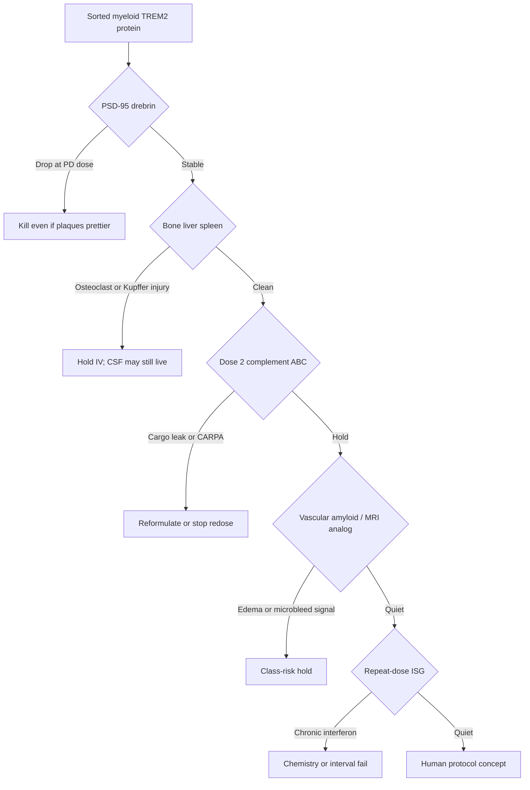

# Safety deep-dive (red-team item 6)

Five ways a “clean” TREM2 PD can still kill the asset. Assays and holds belong in the same protocol as the PD read, not in a later tox appendix. Citations: [references.md](references.md).

---

## 6.1 Synapses — ranked kill, not a footnote

TREM2 is used by microglia to eat phosphatidylserine-tagged synapses in development and in Aβ models. Loss of TREM2 leaves extra ePtdSer+ spines and can sustain neuronal hyperactivity; *more* TREM2 can, in other circuits, drive excess pruning. Both directions are published. That is the opposite of a one-way “clearance is good” story.

Implication for NVL-101: plaque compaction with lost PSD-95 / drebrin / Bassoon is **failure**, not a trade. After AL002, “microglial activation” is no longer assumed synapse-neutral.

**Must-run (same animals as compaction):**
- Hippocampus and plaque-adjacent cortex: PSD-95, drebrin, synaptophysin (IHC + western or MSD).
- Microglia-engulfed PSD-95 (CD68+ puncta inside Iba1).
- Optional: annexin-V+ synaptosomes if the lab can do it.

**Hold / kill:** statistically clear drop in synaptic markers at the PD dose, or a large rise in engulfed PSD-95 without a matching drop in dystrophic neurites (eating healthy synapses, not wreckage).

Dish add-on: iPSC-microglia + human synaptosomes or ePtdSer beads alongside Aβ pHrodo. If TREM2 mRNA increases synapse eating more than Aβ eating, the wedge is the wrong kind of phagocytosis.

---

## 6.2 Peripheral myeloid — the axis is not brain-only

Complete TREM2/DAP12 loss causes Nasu–Hakola disease: bone and CNS.[[7]](references.md) IV LNPs hit Kupffer cells and splenic macrophages first. Extra TREM2 on those cells is an untested endocrine/skeletal experiment.

CSF-first reduces but does not zero peripheral exposure (some efflux, some systemic leak after IT).

**Must-run on first repeat-dose, both routes:**
- Liver: ALT/AST plus Kupffer / vacuolation histology.
- Spleen weight and myeloid flow.
- Bone: qualitative osteoclast histology on a terminal cohort (femur). Quantitative μCT only if histology is ugly.
- Serum CTX-I or TRAP5b if a kit is cheap; not a seed-critical assay.

**Hold:** unexpected bone resorption or persistent Kupffer injury at the CSF PD dose. IV-only injury with a clean CSF PD → drop IV, keep CSF. Injury on both routes → stop.

---

## 6.3 Complement and cargo integrity — dose 2 can fake a PD miss

Anti-PEG IgM plus complement can lyse PEGylated mRNA-LNPs and dump cargo.[[13]](references.md)[[14]](references.md)[[15]](references.md) A beautiful dose-1 myeloid signal that vanishes on dose 2 is ABC until proven otherwise.

Detail and particle levers: [07-complement.md](07-complement.md).

**Must-run:**
- Dose 1 *and* dose 2–3: anti-PEG IgM/IgG, C3a or sC5b-9 at 0.5–2 h, myeloid protein, free-RNA or unencapsulated fraction if the assay exists.
- Shedding C14 PEG-lipid as default unless tropism forbids it.

**Hold:** CARPA physiology, or protein gone on dose 2 with rising anti-PEG. Do not add eculizumab to the product.

---

## 6.4 ARIA-like edema — now a TREM2-class human signal

AL002 (agonist mAb) Phase 2: no CDR-SB benefit, CSF engagement (sTREM2 down, osteopontin up), **ARIA-like MRI as the most frequent AE**. APOE ε4/ε4 enrollment was stopped for severity. Investigators floated microglial activation–mediated amyloid movement around vessels.[[16]](references.md)

So: TREM2 gain-of-function is **not** theoretically ARIA-free. NVL-101 does not target amyloid directly and could still move myeloid cells on CAA-laden vessels. Copy-number might be quieter or louder than occupancy. Unknown.

**Must-run before any human protocol concept:**
- At least one vascular-amyloid or CAA-leaning model *or* APP mice scored for meningeal/cortical vessel-adjacent microglia and Prussian blue / hemosiderin after repeat PD doses.
- Mouse MRI only if a core already runs it; histology is the seed standard.
- Human concept: baseline and on-treatment MRI language copied from anti-amyloid programs; APOE ε4/ε4 exclusion or separate slow-titration until class risk is mapped; no combination with lecanemab/donanemab in first FIH.

**Hold:** vessel-adjacent edema, microhemorrhage, or a human MRI plan that ignores AL002.

---

## 6.5 Interferon — the particle can impersonate the target

Unmodified RNA and empty LNPs drive ISGs.[[8]](references.md)[[9]](references.md) A DAM-like transcriptome after LNP is not TREM2 pharmacology. Chronic intermittent ISG in microglia is its own disease model.

**Must-run:**
- IFIT1, MX1, RSAD2 in iPSC-microglia and in sorted in vivo myeloid cells, empty LNP and irrelevant mRNA subtracted.
- Same panel after dose 3, not only dose 1.
- Chemistry matrix: N1-methylpseudouridine vs unmodified, dsRNA-depleted.

**Hold:** ISG storm at the dose required for surface TREM2. Lower dose or better RNA, do not “push through.”

---

## Human protocol consequences (concept only)

| Topic | Seed implication |
|---|---|
| Route | CSF product → NHP IT/ICM range-finder after mouse pass; DRG and brainstem on the list |
| Monitoring | MRI as if this were an anti-amyloid, not a “safe myeloid” drug |
| Genetics | APOE ε4/ε4 handled explicitly; TREM2-variant enrichment is efficacy logic, not a safety free pass |
| Combination | No anti-amyloid combo in FIH |
| PD | Not sTREM2 alone (AL002 already moved CSF markers and missed the clinic)[[16]](references.md) |
| Redose | Interval from protein curve + anti-PEG, not from a slide |

---

## Minimum safety package on the seed critical path

Tied to the CSF myeloid-protein gate in [09-solutions-1-3.md](09-solutions-1-3.md):

1. Synaptic markers + engulfed PSD-95 at the PD dose.
2. Liver / spleen / bone histology on repeat dose.
3. Dose-2 anti-PEG + complement + protein.
4. Vessel-adjacent hemorrhage screen in an amyloid model.
5. ISG panel dose 1 and dose 3.

If 1 or 5 fail at the only dose that shows myeloid TREM2, the asset is not “almost.” It is done.
