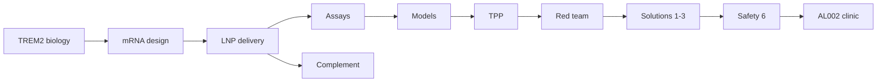

# Science

Technical package for **NVL-101**. Living documents. No clinical claims.

Footnoted literature is collected in [references.md](references.md).

| File | Contents |
|---|---|
| [nvl-101-brief.md](nvl-101-brief.md) | One-page lock |
| [01-trem2-biology.md](01-trem2-biology.md) | Target, genetics, pharmacology wedge |
| [02-mrna-design.md](02-mrna-design.md) | Sequence architecture |
| [03-delivery.md](03-delivery.md) | CSF-first screen |
| [04-assays.md](04-assays.md) | R47H vs agonist |
| [05-models.md](05-models.md) | Humanized TREM2; two ages |
| [06-target-product-profile.md](06-target-product-profile.md) | TPP |
| [07-complement.md](07-complement.md) | CARPA, ABC, PEG |
| [08-adversarial-review.md](08-adversarial-review.md) | Scientific red-team |
| [09-solutions-1-3.md](09-solutions-1-3.md) | Fixes for delivery, wedge, construct |
| [10-safety.md](10-safety.md) | Synapses, periphery, complement, ARIA, ISG |
| [11-al002-clinical.md](11-al002-clinical.md) | INVOKE-1 / INVOKE-2 numbers |
| [references.md](references.md) | Verified citations |
