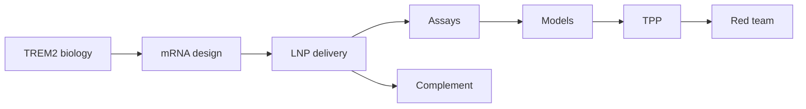

# Science

Technical package for **NVL-101**. Living documents. No clinical claims.

Footnoted literature is collected in [references.md](references.md) (15 confirmed papers).

| File | Contents |
|---|---|
| [nvl-101-brief.md](nvl-101-brief.md) | One-page lock |
| [01-trem2-biology.md](01-trem2-biology.md) | Target, genetics, pharmacology wedge |
| [02-mrna-design.md](02-mrna-design.md) | Sequence architecture and CMC-relevant chemistry |
| [03-delivery.md](03-delivery.md) | BBB vs myeloid tropism, routes, LNP screen |
| [04-assays.md](04-assays.md) | In vitro / in vivo readouts and kill numbers |
| [05-models.md](05-models.md) | Cells, mice, what they can and cannot tell you |
| [06-target-product-profile.md](06-target-product-profile.md) | TPP for seed-stage NVL-101 |
| [07-complement.md](07-complement.md) | CARPA, ABC, PEG, complement blockade |
| [08-adversarial-review.md](08-adversarial-review.md) | Scientific red-team |
| [references.md](references.md) | Verified citations |
