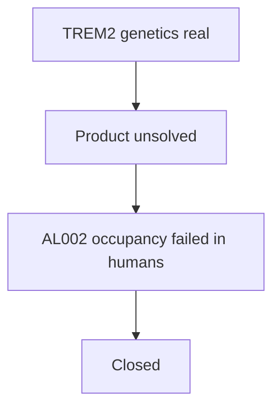

# Science — ARCHIVE

**NVL-101 is closed as infeasible.** See [../CLOSEOUT.md](../CLOSEOUT.md).

These files record the argument. They are not a development plan.

| File | Contents |
|---|---|
| [nvl-101-brief.md](nvl-101-brief.md) | Closed stamp |
| [08-adversarial-review.md](08-adversarial-review.md) | Why the product was not real |
| [10-safety.md](10-safety.md) | Safety vetoes |
| [11-al002-clinical.md](11-al002-clinical.md) | Human occupancy numbers |
| [references.md](references.md) | Citations |
| Remaining 01–07, 09 | Historical design notes |
